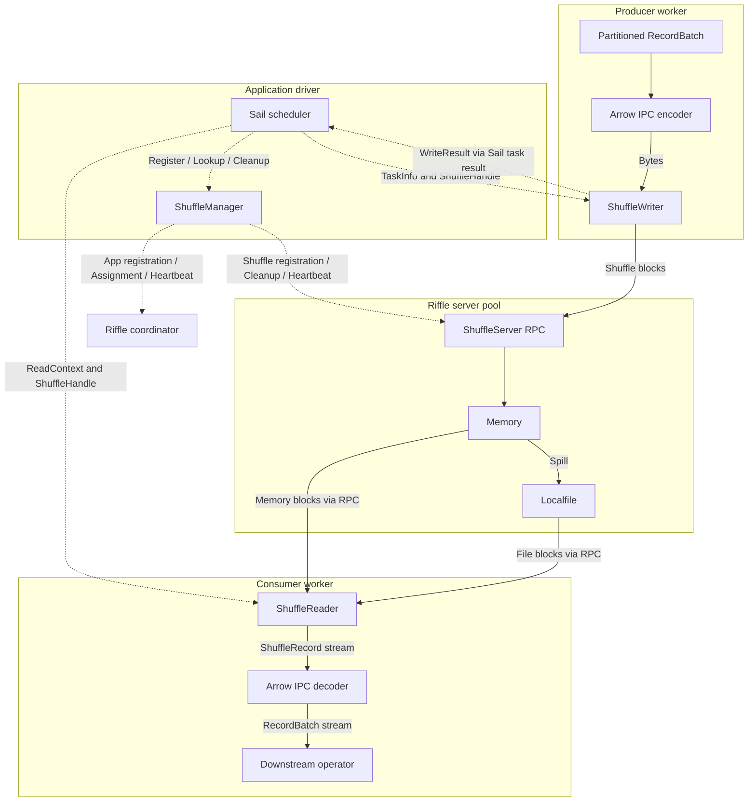
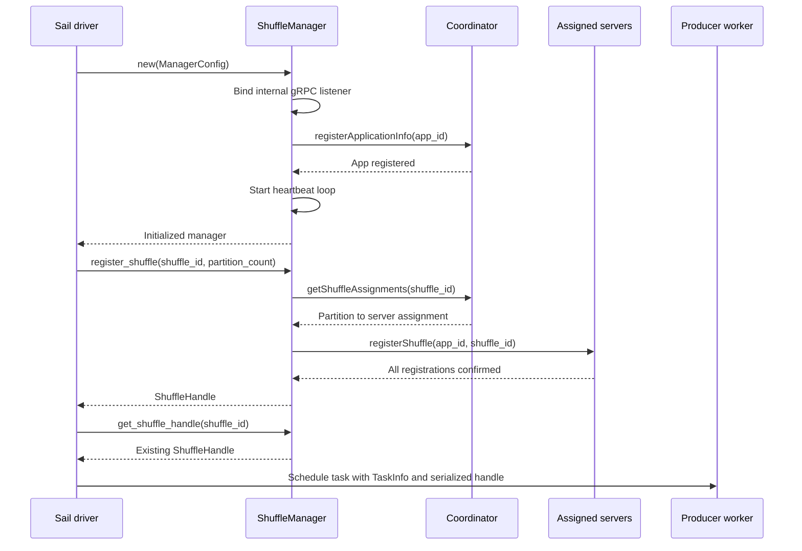
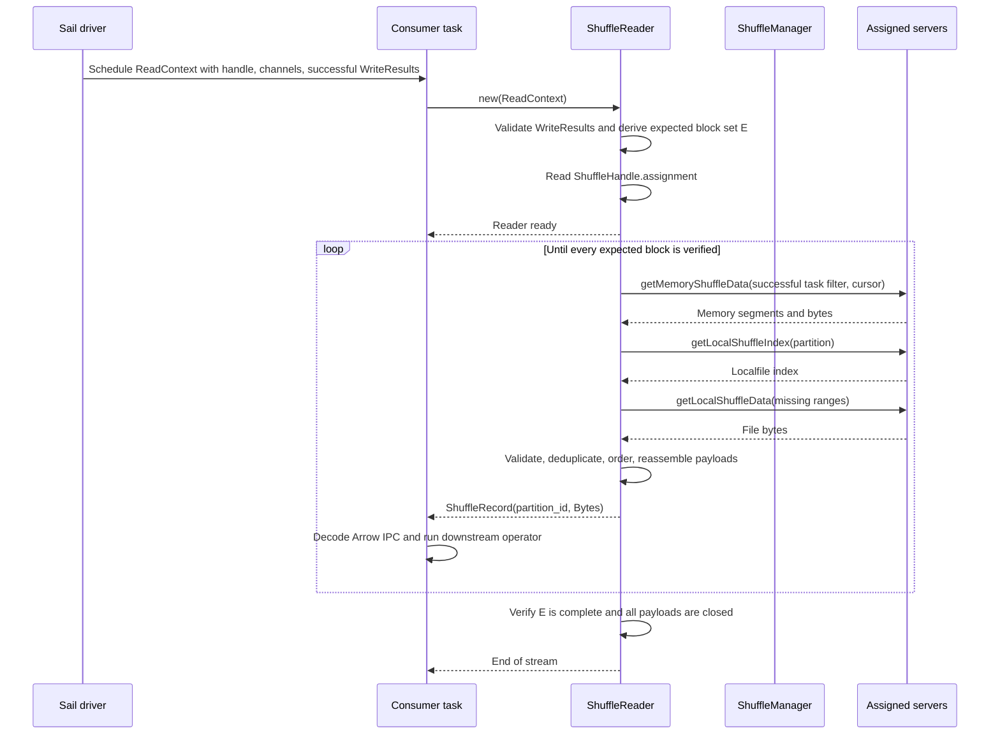
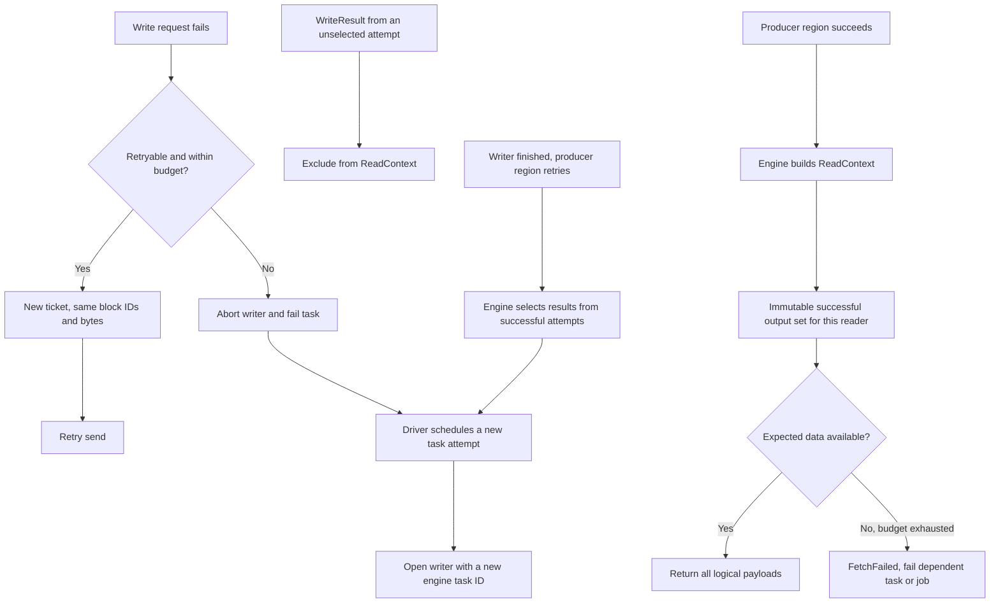
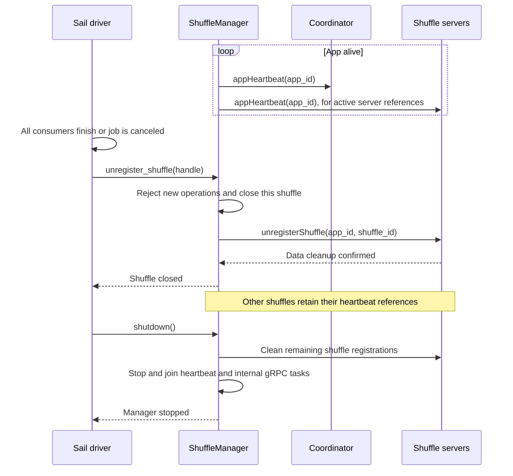

# riffle-client 数据流与公开接口设计

状态：writer 已加入有界后台批量发送；writer/reader 直接读取 handle 中的 assignment。按用户要求，整个 client 不添加测试，新增行为仅通过格式与编译检查验证。日期：2026-10-16。

源码基线：Riffle `0d5ffdf00547ad1247ece1b7012cade0cdc92b1d`；Sail `fec3ecd518af7ac17ce80b12c527c700eaf3e712`。

## 0. 当前实现与消融记录

入口是 [client 公开类型](/Users/zuston/dev/riffle2/riffle-client/src/lib.rs)、[manager](/Users/zuston/dev/riffle2/riffle-client/src/manager.rs)、[writer](/Users/zuston/dev/riffle2/riffle-client/src/writer.rs)、[reader](/Users/zuston/dev/riffle2/riffle-client/src/reader.rs) 与 [Sail adapter](/Users/zuston/dev/sail/crates/sail-execution/src/stream/riffle.rs)。client 直接依赖 server，没有新增独立 proto crate。

当前实现与边界：

- `write()` 将一个 payload 放入有界队列后返回；后台按 server 批量发送。每个 writer 默认数据预算 64 MiB、批量阈值 4 MiB、并发上限 4、刷新间隔 20 ms。单个 payload 仍限制为 16 MiB，不自动分片。
- reader 先获取一个 partition 的完整数据，再按 block ID 顺序输出；缓存上限为 64 MiB，超过上限明确失败。`Stream` 接口保留，后续可替换为增量预取。
- writer 单次 RPC 默认超时 5 秒，数据发送和结果上报各最多尝试 8 次；可恢复错误使用带抖动的指数退避，不可恢复错误直接返回。reader 缺块扫描仍最多 5 轮。
- manager 保留 `GetAssignment` RPC；writer/reader 初始化直接使用 `ShuffleHandle.assignment`，finish/abort 不调用 manager，不维护任务映射。
- `WriteResult` 只保存 app/shuffle 身份、引擎提供的 task ID 和各 partition 的 block 数；一条 payload 就是一个 block，没有额外 framing。
- 错误先使用 `anyhow::Error`；manager shutdown 取消自己的后台任务，未实现 HA、TLS、节点恢复、多副本或远端存储读取。
- server 的两个 RPC middleware 保留原始 `impl Future` 和 feature gate，避免给热路径增加 boxing 分配；Sail 接入使用 nightly。protobuf 生成到 `OUT_DIR` 的改动保留。

以下为旧版同步 writer 的历史联调记录，不代表新版后台 writer 已完成端到端验证。使用一个本地 coordinator、两个 `MEMORY_LOCALFILE` server、Sail local-cluster 的两个 worker 做端到端验证。临时查询脚本在仓库外，不新增单元/集成测试文件。查询覆盖 10 万行重分区聚合、空输出 map、join 和 cross join；结果分别为 10 万行分组统计、3 行、join sum `500500`、cross join 3000 行且 sum `1498500`。两个节点都有 memory 与 localfile 读取，16 KiB spill 阈值产生实际落盘数据。

消融删除了 adapter 的 `RiffleDriver::Local/Remote` 枚举和两套 metadata 请求路径，统一复用 Sail 已有 `DriverClient`。adapter 从 226 行降到 188 行；加上 driver/worker 初始化变化，三个相关文件净减少 33 行。内部入口统一为 `ShuffleService`，复用现有 external shuffle 的创建/读取/清理流程。删减前后的四类查询结果完全一致；单次启动耗时波动明显，不将这些查询计时当作性能基准。

以下数据流与接口描述已对齐这版实现；后面的边界矩阵是人工验收检查项，不代表故障注入、压力或生产部署已经验证，不据此新增 client 测试。

## 1. 建议结论

新增 workspace crate `riffle-client`，直接依赖 `riffle-server`，关闭 server 的默认 features；不拆分 `riffle-proto`。公开的运行角色保持三个：`ShuffleManager`、`ShuffleWriter`、`ShuffleReader`。

- `ShuffleManager` 运行于 application driver，管理 app 生命周期、shuffle 注册、assignment、heartbeat 和清理，并提供 crate 自带的内部 gRPC；不管理 task 写入结果或引擎的完成屏障。
- `ShuffleWriter` 运行于 worker，每个 map task attempt 一个 writer，覆盖该 task 的所有输出 partition，接收已经分区的 `Bytes`。
- `ShuffleReader` 运行于 worker，接收一个 shuffle 和一个或多个 reduce partition，返回异步数据流；隐藏多节点、memory/localfile、block ID、bitmap、CRC 和重试。

Sail 侧保留分区和 Arrow IPC 编解码，client 不依赖 Sail、Arrow 或 DataFusion。现有 `TaskStreamWriter` / `TaskStreamSink` / `TaskStreamReader` 可以适配这三个角色，不需要改变执行算子的分区算法。

最重要的接口决策：**writer 的 `finish()` 等待 server 写入和结果上报完成，返回 `WriteResult` 给引擎，不调用 manager。引擎按自身 task 成功与调度屏障选择结果，并把成功输出放入 `ReadContext`。** manager 负责路由与生命周期，writer/reader 负责数据访问，引擎负责执行和 attempt 选择。

## 2. 当前代码约束

| 事实 | 设计影响 | 源码 |
| --- | --- | --- |
| server 已导出生成的 coordinator / shuffle gRPC client | 直接复用协议，无须新建 proto crate | [protobuf/mod.rs](/Users/zuston/dev/riffle2/riffle-server/src/grpc/protobuf/mod.rs) |
| coordinator 提供 assignment，server 分别提供注册、预留 buffer、发送、结果上报、memory 和 localfile 读取 | client 可以组合现有 RPC 完成数据路径 | [uniffle.proto](/Users/zuston/dev/riffle2/riffle-server/src/grpc/protobuf/uniffle.proto) |
| `commit_shuffle_task` 返回不支持，`finish_shuffle` 当前只返回成功 | 不能依赖这两个 RPC 提供提交或持久化屏障 | [grpc/service.rs](/Users/zuston/dev/riffle2/riffle-server/src/grpc/service.rs:714) |
| `report_shuffle_result` 将多个 attempt 的 block ID 合并到 bitmap | server bitmap 不能独立决定哪个 attempt 应被读取 | [block_id_manager.rs](/Users/zuston/dev/riffle2/riffle-server/src/block_id_manager.rs) |
| localfile index 已有公开的 40-byte codec | 复用 `IndexCodec`，不再手写同一份二进制布局 | [index_codec.rs](/Users/zuston/dev/riffle2/riffle-server/src/store/index_codec.rs) |
| memory cursor 所指 block 可能随 spill 消失；`is_end` 只描述本次 memory 扫描 | 读取结束必须根据预期 block 集合判断，不能根据 memory EOF 判断 | [default_buffer.rs](/Users/zuston/dev/riffle2/riffle-server/src/store/mem/buffer/default_buffer.rs:98) |
| hybrid 的文件 RPC 路径读取 warm store；未提供统一远端层读取 | 首版部署限定 `MEMORY_LOCALFILE`，不能宣称支持 HDFS 层 | [hybrid.rs](/Users/zuston/dev/riffle2/riffle-server/src/store/hybrid.rs:742) |
| Riffle 使用 tonic fork 0.10.2 / prost 0.12；Sail 使用 tonic 0.14 / prost 0.14 | 不公开 protobuf、tonic channel、request、status 或 server 类型 | 两仓库的 Cargo manifests / Riffle Cargo.lock |
| server 使用 nightly associated impl trait；Sail 声明 Rust 1.97.1 | 直接依赖仍有工具链障碍，关闭默认 features 无法消除 | [server/lib.rs](/Users/zuston/dev/riffle2/riffle-server/src/lib.rs:19)、[Sail Cargo.toml](/Users/zuston/dev/sail/Cargo.toml:15) |

这些约束来自源码；第 0 节记录本轮实际接通的范围，其余完整故障矩阵仍待后续验证。

## 3. 数据流设计

图中的角色、消息和状态使用 English，说明使用中文。图示为拟定的 client 行为；coordinator/server 的 RPC 名对应已有协议，client 内部 manager RPC 为新增设计。

### 3.1 进程边界与数据所有权

实线表示 payload 流向，虚线表示控制消息或元数据。`ShuffleManager` 与 Sail driver 在同进程；writer/reader 通过 client 内部 gRPC 访问它。Arrow 编解码位于 Sail adapter，server 数据不会经过 driver 转发。



| 数据 | 权威持有方 | 接收方与用途 |
| --- | --- | --- |
| shuffle ID、当前有效 task attempt、producer 屏障 | Sail driver | 分配 app 生命周期内不复用的 shuffle ID；选择成功任务结果，构造下游 ReadContext |
| shuffle ID 到 handle、assignment | manager | driver 查询 handle；writer/reader 内部查询路由 |
| shuffle 内唯一、重试不复用的 task ID | Sail adapter | 用执行分区编号和 attempt 编码；client 只校验 23 位范围 |
| 写入摘要与成功 task 的 WriteResult 集合 | writer 产生、引擎持有 | 随任务结果传递，reader 过滤与完整性检查 |
| Arrow schema、partitioning、IPC 编解码 | Sail adapter | writer/reader 只接收或返回 bytes |
| payload blocks 与 localfile index | Riffle server | writer 直接写入，reader 直接读取 |

### 3.2 初始化、注册与 handle 分发



`register_shuffle()` 返回 handle，`get_shuffle_handle()` 用于之后构造任务时查询已有 handle；图中两次返回的是同一个注册。handle 携带 assignment，由 client 内部的 writer/reader 直接使用，引擎只负责序列化和转发，不解释 server 路由。

### 3.3 写入与引擎任务结果

```mermaid
sequenceDiagram
    participant D as Sail driver
    participant P as Producer task
    participant W as ShuffleWriter
    participant M as ShuffleManager
    participant S as Assigned servers
    P->>W: new(TaskInfo)
    W->>W: Read ShuffleHandle.assignment
    W-->>P: Writer ready
    loop Partitioned payloads
        P->>W: write(partition_id, Bytes)
        W->>W: Reserve queue capacity, assign block ID, compute CRC, enqueue
        W->>S: requireBuffer(size)
        S-->>W: Buffer ticket
        W->>S: sendShuffleData(ticket, blocks)
        S-->>W: Data accepted
    end
    P->>W: finish()
    W->>W: Drain all pending writes
    W->>S: reportShuffleResult(confirmed block IDs)
    S-->>W: Result recorded
    W-->>P: WriteResult(task identity, opaque output summary)
    P-->>D: TaskSucceeded(TaskKey, serialized WriteResult) via Sail
    D->>D: Validate current attempt and store its task result
    Note over D,P: Repeat for all producer tasks
    D->>D: Producer region succeeds; build ReadContext from successful results
    D->>D: Release downstream task scheduling
```

writer 初始化时校验引擎提供的 task ID，直接读取 handle 中的路由；写完后等待后台发送排空和 server 结果上报确认，返回 `WriteResult` 给调用方。writer 不向 manager 汇报完成，manager 不保存任务映射或输出摘要。Sail adapter 将结果沿引擎的任务结果通道送到 driver；引擎通过 `WriteResult.task_id()` 校验结果身份并转发摘要，不解释底层 block ID。

Sail 的 [region 重试逻辑](/Users/zuston/dev/sail/crates/sail-execution/src/driver/job_scheduler/core.rs:375) 会给 region 内任务建立新 attempt。因此成功输出选择和 producer 屏障仍由引擎处理，不能由 client 根据写入完成顺序决定。引擎仅将最终成功 attempt 的 `WriteResult` 放入下游 context。

`WriteResult` 的摘要按 task ID 和 partition 保存连续 block 数量；`blocks_number: BTreeMap<u32, u32>` 的 key 是输出 partition ID，value 是该 task 写入的 block 数量。reader 用 task ID、partition ID 和 `0..block_count` 的 sequence 独立推导预期 block 集合。它来自成功的 `finish()`，不依赖 server 当前无提交语义的 `finishShuffle` RPC。

### 3.4 下游读取与完整性终点



memory 与 localfile 请求按缺失集合选择，不要求每轮全部调用。`is_end` 仅结束一次 memory 扫描；不能直接结束逻辑 shuffle stream。缺少预期数据时，在有限重试后返回错误。broadcast 是多个 consumer 各自读取完整集合；reader drop 只取消自己的请求。

### 3.5 失败与重试分支



各 attempt 的输出可以同时留在 server；引擎决定哪些 `WriteResult` 成功并进入 context。reader 只访问 context 中的输出，不会因迟到任务或 server bitmap 增长而改变读取集合。首版不对已返回部分数据的 stream 重播整个 partition，也不把数据丢失自动变成对新 server 的空读取。

### 3.6 heartbeat 与生命周期收尾



### 3.7 从跨边界调用反推接口

| 调用边界 | 必需公开接口 | client 内部行为 |
| --- | --- | --- |
| driver 创建 app 管理器 | `ShuffleManager::new` | app 注册、gRPC listener、heartbeat |
| driver 创建 / 查找 producer shuffle | `register_shuffle` / `get_shuffle_handle` | 校验 shuffle ID、coordinator assignment、server 注册 |
| worker 创建一次写入尝试 | `ShuffleWriter::new` | 校验引擎提供的 task ID 范围；直接使用 handle 中的 assignment |
| worker 提交已分区的 payload | `ShuffleWriter::write` | 等待容量、CRC、入队；后台申请 ticket、批量发送与有限重试 |
| worker 完成 / 放弃该尝试 | `finish` / `abort` | server 结果上报并返回 WriteResult / 丢弃本地缓存；均无完成 RPC 到 manager |
| 引擎构造下游输入 | `ReadContext` 携带成功的 `WriteResult` | task 成功选择与 producer 屏障属于引擎，无 manager 接受方法 |
| worker 打开下游数据流 | `ShuffleReader::new` / `stream` | context 校验、路由、跨层读取、去重与重组 |
| driver 释放 shuffle / app | `unregister_shuffle` / `shutdown` | server 清理、heartbeat 引用回收、后台任务退出 |

`GetAssignment` 作为内部路由查询 RPC 保留；当前 writer/reader 不调用它，也不实现路由刷新。公开接口只覆盖上表实际存在的引擎调用边界。

## 4. 范围与方案选择

| 方案 | 范围与收益 | 成本、风险与验证 |
| --- | --- | --- |
| A：固定每个 shuffle 的 assignment，driver 决定完成的 attempt；首版采用 | 涉及新 client crate、server 的生成代码输出位置、Sail 适配；使用 nightly，可实现 blocking shuffle、正常 task retry、跨节点与跨层读取 | 单副本节点丢失会失败；通过真实 memory/localfile spill 和 Sail 查询验收 |
| B：运行中重分配 partition 并恢复输出 | 在 A 上增加 assignment 历史、旧节点读取、未完成数据重放、副本一致性和 shuffle generation 恢复 | 单独刷新路由无法搬迁旧数据；需要 coordinator/server 故障注入与引擎重算协议，首版成本显著增加 |

首版使用 A，`dataReplica = 1`，不同 partition 可分配到多个 server；“多个节点访问”首先覆盖这种分布。assignment 刷新由内部 gRPC 提供，返回该 shuffle 的权威快照，但不在已有数据的 shuffle 上静默更换归属节点。

暂不做：URPC、HDFS/object storage 读取、在线 reassignment、多副本 quorum、pipelined shuffle、manager HA、失败后自动跨 generation 重算。公开接口不暴露其底层实现，后续可以扩展。

## 5. 公开接口草案

以下为拟定的 Rust 签名契约，省略实现。除 `bytes::Bytes`、`futures::Stream`、serde 和标准库类型外，不要求调用方使用底层依赖类型。

```rust
pub type Error = anyhow::Error;
pub type Result<T> = anyhow::Result<T>;
pub type ShuffleStream =
    Pin<Box<dyn Stream<Item = Result<ShuffleRecord>> + Send + 'static>>;

#[derive(Clone, Debug, Serialize, Deserialize)]
pub struct Endpoint {
    pub host: String,
    pub port: u16,
}

#[derive(Clone, Debug, Serialize, Deserialize)]
pub struct ShuffleHandle {
    app_id: String,
    shuffle_id: usize,
    manager_endpoint: Endpoint,
    partition_count: u32,
}

#[derive(Clone, Debug, Serialize, Deserialize)]
pub struct WriteResult {
    // Private app/shuffle identity, engine task ID, and partition block counts.
}

impl WriteResult {
    pub fn task_id(&self) -> usize;
}

pub struct TaskInfo {
    pub shuffle: ShuffleHandle,
    pub task_id: usize,
}

pub struct ReadContext {
    pub shuffle: ShuffleHandle,
    pub partitions: Vec<u32>,
    pub write_results: Vec<WriteResult>,
}

pub struct ShuffleRecord {
    pub partition_id: u32,
    pub data: Bytes,
}

impl ShuffleManager {
    pub async fn new(config: ManagerConfig) -> Result<Self>;
    pub async fn register_shuffle(
        &self,
        shuffle_id: usize,
        partition_count: u32,
    ) -> Result<ShuffleHandle>;
    pub fn get_shuffle_handle(&self, shuffle_id: usize) -> Result<ShuffleHandle>;
    pub async fn unregister_shuffle(&self, shuffle: &ShuffleHandle) -> Result<()>;
    pub async fn shutdown(&self) -> Result<()>;
}

impl ShuffleWriter {
    pub async fn new(task: TaskInfo) -> Result<Self>;
    pub async fn with_options(task: TaskInfo, options: WriterOptions) -> Result<Self>;
    pub async fn write(&mut self, partition_id: PartitionId, data: Bytes) -> Result<()>;
    pub async fn finish(self) -> Result<WriteResult>;
    pub async fn abort(self) -> Result<()>;
}

impl ShuffleReader {
    pub async fn new(context: ReadContext) -> Result<Self>;
    pub fn stream(self) -> ShuffleStream;
}
```

### Handle 与标识

`ShuffleHandle` 是可序列化的 client 描述符，包含私有的 app ID、`usize` shuffle ID、自定义 `Endpoint { host: String, port: u16 }` manager 地址和 partition 数量；不包含活跃 channel 或后台任务。地址按 host、port 两个字段序列化，连接时再构造 gRPC URI，IPv6 host 补齐括号。shuffle 在 app 内只由调用方提供的 ID 标识，没有额外的实例标识。首版 writer 内按 server 复用 channel，reader 按 partition 建立读取连接，没有额外的全局传输 cache。

- `register_shuffle(shuffle_id: usize, partition_count: u32)` 直接接收注册参数。shuffle ID 由引擎提供，在 app 内唯一；同 ID、同 partition 数量重复注册返回相同 handle，数量不同返回冲突。
- driver 可通过 `get_shuffle_handle(shuffle_id)` 查询并 clone 已注册的 handle。查询只访问 manager 本地状态，是同步操作；不存在返回 `ShuffleNotFound`，注册未完成返回 `ShuffleNotReady`，正在注销或已经注销返回 `Closed`。`Registered` 时可取得 handle；是否启动下游读取由引擎的任务依赖和结果集合决定。
- manager 直接使用调用方提供的 shuffle ID，不再分配或映射 ID。client 内部身份统一使用 `usize`，现有协议使用 `i32`；注册和各 RPC 边界通过 checked conversion 限制到 `0..=i32::MAX`，越界返回错误，本地 handle 查询直接按 `usize` 查表。
- 引擎必须保证 shuffle ID 在 app 生命周期内不复用，包括注销后重新注册的场景；manager 不保存已注销 ID 的历史。重新创建同一 producer 的 shuffle 时，引擎需分配新 ID，避免旧 handle 访问新数据。
- Sail 适配层维护 `(job, producer stage) -> shuffle_id`，在 app 范围内分配 ID；多个 job 的同号 stage 必须隔离，不能直接把 `stage` 当作 shuffle ID。
- map ID 对应上游 task 的输入 partition；partition ID 对应下游 channel。二者不能混用。
- client 不接收 map 数量，不校验 map ID 范围、重复 map 或成功 map 结果是否收齐；成功结果的选择与完整性由计算引擎保证。partition 数量用于 coordinator 分配路由及读写的 partition 范围校验。
- `TaskInfo.task_id: usize` 由引擎提供，必须在 shuffle 内唯一且每次重试使用不同 ID。client 直接将其用于 Riffle 的 `taskAttemptId` 和 block ID，默认 layout 要求 `task_id < 2^23`；超限明确失败，不截断。
- manager 不分配任务 ID、不绑定 writer 身份、不保存任务映射，也不跟踪 writer 完成。一次 writer 的网络重试保留 task ID 和 block ID；任务重新执行时由引擎提供新 task ID，不能以相同 ID 重放不同输出。
- 所有整数转 protobuf `i32/i64`、layout 位数限制、累计长度均做 checked validation，溢出返回明确错误，不截断。

`ShuffleHandle` 不提供访问 protobuf、bitmap、block layout 或 assignment 的 getter。它会被引擎序列化和转发，但引擎不解释其内部字段。

Sail driver 在构造 producer/consumer task 描述时按 shuffle ID 查询 handle，再随任务传给 worker。worker 使用该 handle 获取路由；成功写入结果沿引擎任务结果通道传递，不经 manager。`get_shuffle_handle()` 不隐式注册、申请新 assignment 或替换旧 handle。

### 配置边界

`ManagerConfig::new(app_id, coordinator_endpoints)` 提供本地默认值，user、监听地址、advertised host 和 server tags 为可调字段。绑定 `0.0.0.0` 不能自动成为广播地址；实际端口绑定成功后再发布 handle。

`ShuffleManager::new(config).await` 完成 app 注册、heartbeat 与内部 gRPC 初始化后返回可用实例；初始化失败会清理已启动的资源。

首版 heartbeat、RPC deadline、重试次数和数据大小上限使用内部常量。client 使用调用方 Tokio runtime，不再创建 runtime；不初始化 server 的日志、allocator、signal handler 或全局服务。

首版不增加任意 server properties 透传作为公开必填项。部署通过专用 server tag 选择确认过的 `MEMORY_LOCALFILE` 节点；现有 assignment 协议没有完整存储能力协商，tag 的正确配置是部署前提，不能把 tag 描述成自动探测。

## 6. Manager：生命周期与路由

### 注册与 heartbeat

1. 启动内部 gRPC，注册 app 信息；失败时停止已启动任务并返回错误。
2. 同一个 shuffle 的并发注册合并成一次 coordinator assignment 请求。
3. 校验 assignment 覆盖所有 partition，无重叠、越界、缺失或空 server 列表；首版每个 partition 一个 server。
4. 向涉及的所有 server 执行 `registerShuffle`。全部成功后才发布 handle；部分失败时尽力回滚本次已成功注册的节点，未清理部分依赖 app TTL。首版没有额外的清理重试队列。
5. 对 coordinator 和 app 涉及的 server 发送 app heartbeat。server app heartbeat 是 app 级的，同 app 的多个 shuffle 不各自建立重复 heartbeat loop。

同 app 的其他 shuffle 正在注册或使用某个 server 时，不能因为一个 shuffle 注销就停止对该 server 的 heartbeat。清理期间继续 heartbeat，显式 shutdown 完成清理或达到清理 deadline 后停止。

### 状态边界

```text
Manager shuffle: Registering -> Registered -> Unregistering -> Closed
Writer:          Writing -> Finished(WriteResult)
                 Writing -> Aborted
Engine:          Successful task results -> Producer barrier -> ReadContext
```

manager 注册成功即提供稳定路由；它没有 task 映射、结果表、完成计数或读取快照，也不根据写入进度切换可读状态。`GetAssignment` 请求只携带 shuffle ID，不处理任务身份或完成事件。

引擎持有成功任务的 `WriteResult`，决定 producer 屏障和下游启动，并保证 map ID 有效、每个 map 只选择一个成功结果且集合完整。reader 从引擎提供的 `ReadContext` 构造自己的不可变读取集合，不判断 map 结果是否收齐；晚到的其他输出不加入本次读取。零 map 时 context 的结果集合为空；`partition_count = 0` 拒绝。

`finish()` 不承诺 fsync、所有数据落盘或机器丢失后的持久性。当前 server 的成功确认意味着数据已被接收，可能仍在 memory 中；server `reportShuffleResult` 上报的是数据元信息，不代替引擎认定 task 成功。

### 注销与退出

`unregister_shuffle()` 向相关 server 清理这个 shuffle，全部成功后移除注册；重复注销幂等，部分失败仍保留注册供重试。调用方必须在消费者结束后注销；首版没有额外的在途 reader/writer 租约。共享 app 的其他 shuffle 不受影响。

Sail 在所有消费者完成、stage/job 清理时注销 producer shuffle，不能在 producer 刚结束时删除。最后 `shutdown()` 停止新操作、尝试清理所有剩余 shuffle，然后取消自己的 heartbeat/gRPC 任务。manager 崩溃后靠 server 的 app TTL 回收；首版不恢复 manager 状态，由引擎负责废弃旧 handle，并保证 app 内的 shuffle ID 不复用。

## 7. Writer：字节接口与底层封装

一次 `write(partition_id, data)` 表示一个逻辑 payload，client 保留消息边界；成功只表示数据进入有界发送路径，不等同于整个 task 已完成。

- 一个 writer 管理该 task 的全部 reduce partitions，不为每个 channel 创建独立的 task 提交。
- `write().await` 先等待字节预算与队列容量，再同步入队并递增 block sequence；等待容量时取消不会留下 sequence 空洞。后台按 server 归并请求，按批量阈值、block 数上限或刷新定时器发送；并发受 `WriterOptions.max_in_flight_requests` 限制。
- 队列、待发送 batch 和在途请求共享每个 writer 的字节预算，重试完成前不释放预算。零长度 payload 也计入固定 metadata 开销。该预算不包括 transport 编码缓冲、路由和结果摘要，以及 `Bytes` 切片可能持有的底层大分配；它不是进程级内存硬上限。
- 一次 payload 对应一个物理 block，16 MiB 以上明确拒绝。后续若需要自动分片，再在 client 内增加格式和重组逻辑，不要求引擎操作底层 block。
- 空 `Bytes` 是合法 payload，和“该 partition 没有任何 write”不同；发送时至少预留一个字节的 ticket，实际未用部分由 server 释放。
- 对每个 `(task_id, partition)` 维护连续 block sequence，复用 server `IdLayout` 生成 block ID，复用 CRC 实现；首版沿用现有默认 layout，超过 sequence/task ID 限额时明确失败。
- 每次发送先 `requireBuffer`，再 `sendShuffleData`；业务 `StatusCode` 与 tonic transport 结果都检查。
- 发送超时可能发生在服务端已插入之后。重试使用完全相同的 block ID、payload 与 CRC，但重新申请 buffer ticket；不能重用已消费的 ticket，也不能生成新 block ID。
- server 可能部分接收一个请求，不能把请求失败推断为完全未写入。reader 按 block ID 去重；只有全部输出发送确认和 server 结果上报成功后，才返回 `WriteResult`。
- `finish(self)` 关闭输入并等待后台发送全部确认，再按每请求最多 16,384 个 block ID 分批执行 `reportShuffleResult`，各 server 的上报并发受相同上限约束。数据发送与结果上报都成功才返回摘要；没有输出的 map 返回空摘要。完成路径不调用 manager，重试始终使用 handle 中的固定路由。
- 后台失败会关闭容量等待并传播到后续 `write()` 和 `finish()`。drop writer 或取消 `finish()` 会取消发送任务；`abort()` 还会等待任务退出。可恢复错误有限重试，不可恢复状态直接使本次 writer 失败。
- `abort(self)` 丢弃未发送缓存、取消本地 in-flight 工作，不向 manager 汇报完成或作废。已写入 server 的数据不做逐 task 删除，随 shuffle 注销或 app TTL 清理。finish/abort 均消费 writer。
- Drop 只触发本地取消和尽力清理，不能依靠 Drop 执行可靠 async commit。失败或未被引擎采用的输出不进入下游 `ReadContext`。

同一 map、同一 partition 按 `write` 调用顺序交付；不同 map 或不同 partition 之间不承诺全局顺序。首版使用单一 payload 格式，不增加可插拔 serializer/compressor trait；Sail 可自行设置 IPC compression。

## 8. Reader：多节点、跨层、完整性

使用 `Stream`，每条返回 `ShuffleRecord { partition_id, data }`，其中 `data` 恢复到一次 `write` 的消息边界。`ReadContext.partitions` 支持多个 partition，以覆盖 Sail broadcast 或多 channel 合并；空列表直接返回空流，重复 partition 规范化去重，越界则拒绝。

reader 的输入来自引擎传入的 `ReadContext.write_results`，每个结果含 app/shuffle 身份、引擎 task ID 和分区摘要。打开时仅校验结果属于同一 app 和 shuffle、task ID 的 23 位范围、partition 和 block 计数边界。task ID 唯一性、map ID 有效性、每个 map 只选一个成功结果及结果集合完整性均由引擎保证，client 不保存任务映射或检查 map 数量。assignment 直接从 handle 获取，读取期间不跟随引擎后续变动的结果选择。

`WriteResult` 可序列化，字段保持 private；通过 `task()` 读取逻辑任务身份，引擎转发元数据即可，不自行构造 block ID/bitmap。大 shuffle 的结果元数据同样受 metadata 和引擎消息大小上限限制；首版不承诺无限大小的 task result 或 context。

读取算法必须满足：

1. 从成功的 `WriteResult` 摘要推导选定 partition 的预期 block 集合 `E`；首版不额外调用 `getShuffleResult`。不能以当前 server 返回的集合代替预期集合，否则会漏掉完全丢失的 block 或结果元数据。
2. 按 assignment 访问相关 server。memory 请求携带 context 中的成功 task ID bitmap，localfile index 同样过滤 task 与预期 block；被失败 attempt 写入的数据不能交付给调用方。
3. memory segments 和 localfile index 均校验 block ID、task ID、offset、length、边界和 CRC。CRC 正确之前，不将 block 记为已交付。
4. 跨 RPC 重试、memory spill、localfile 和重复插入按 block ID 去重。取得完整 partition 后按 block ID 顺序输出，每个 block 返回一次原始 payload；同一 map 的 sequence 顺序保持。
5. 不能一次 memory 扫描结束后就认为数据完整。针对缺失块刷新 localfile index 并重新扫描必要 memory 页；memory cursor 消失时允许从 `-1` 重扫，用 seen 集合过滤。
6. spill 时允许 memory 与 localfile 短暂同时可见，也允许一次 index 快照尚未包含后续 spill。只有完整拿到 `E`，且逻辑 payload 全部闭合，才返回 EOF。
7. 在有限重试后仍有缺失块，返回带 partition 和缺失数量的错误；不能把缺失当作空 partition。

首版先获取并缓存一个完整 partition，最多 64 MiB，再输出记录；不会一次缓存整个 shuffle。`reader.rs` 的 shortcut 注释明确了以后替换为增量 prefetch 的位置。

**资源限制：**现有 localfile index RPC 返回整份 partition index，预期 block 集合也随 block 数增长。首版限制 payload buffer 与 gRPC 消息大小，尚未建立统一 metadata 内存预算，不能承诺全部 metadata 的常量内存或无限大 partition。将来需要分页时再扩展 server RPC。

drop 返回的 stream 即取消本次读取，释放当前请求与 buffer；没有额外预取任务。它不会注销 shuffle，其他消费者仍可继续读取。

## 9. 内部 gRPC 与错误边界

新增 `riffle-client/proto/manager.proto`，只定义 client 自己的管理协议，生成到 `OUT_DIR`，不改变或移动现有 `uniffle.proto`。使用独立 package/service 名，避免和现有 protobuf 中的 `ShuffleManager` service 冲突。

| 内部 RPC | 用途 |
| --- | --- |
| `GetAssignment` | 按 shuffle ID 返回已注册 shuffle 的固定路由，不处理任务身份 |

该 RPC 使用 `GetAssignmentRequest` 和 `GetAssignmentResponse`。每条 `PartitionAssignment` 只描述一个 `partitionId`，其 endpoint 使用独立消息 `Endpoint { host, port }`；不返回 partition range 或 URI 字符串。coordinator 返回的 range 在 manager 内展开为 `partition_id -> Endpoint`，writer/reader 按 partition ID 直接查找路由。

内部 RPC 只处理路由，writer 完成和取消均不调用它们。`get_shuffle_handle`、注册、注销和 app shutdown 是 driver 的本地管理操作，不作为 worker RPC 暴露。路由 RPC 按 shuffle ID 查找注册，不接收 task ID、校验 map ID 范围或维护 manager 实例标识。首版沿用 Riffle 的受信集群网络部署前提，不把它宣称为多租户认证隔离方案。

首版公开 `Error` / `Result` 复用 `anyhow`，保留 RPC operation、业务 status 与错误描述。暂不建立单独的错误分类层；引擎按外部错误传播，后续需要区分可恢复故障时再增加结构化错误。

重试由 client 按操作语义决定，受单次 RPC deadline 和总预算共同约束。参数错误、冲突、越界、确定性损坏不无限重试；无法恢复的 fetch failure 向引擎传播，不能在已经返回部分数据后透明重播整个 partition。

## 10. Sail 接入证明

### 对应关系

| Sail 现有概念 | riffle-client 接口 / 行为 |
| --- | --- |
| session / application driver | 一个 `ShuffleManager`；app ID 包含 session 和 driver 实例，避免同 session 多 driver 冲突 |
| producer `(job, stage)` | Sail 适配层分配 `shuffle_id: usize`，由 driver 注册一次；构造任务时通过 `get_shuffle_handle(shuffle_id)` 查询 |
| stage 输入 partition 数量 | 由 Sail 调度器维护，client 不接收 |
| `TaskOutput.channels()` | `register_shuffle` 的 `partition_count` 参数 |
| `TaskKey.partition` / `TaskKey.attempt` | Sail 适配层计算 `task_id = attempt * stage_partition_count + partition`，使用 checked arithmetic；client 校验 23 位范围 |
| `TaskStreamWriter::open(partition)` | 校验对应 task partition，创建一个 `ShuffleWriter` |
| `TaskStreamSink::write(Vec<Option<RecordBatch>>)` | 遍历 channel，独立 IPC 编码非空 batch，调用 `writer.write(channel, bytes)` |
| `TaskStreamSink::commit()` / `abort()` | `writer.finish()` 返回的 WriteResult 缓存在 Sail task runner；abort 取消本地 writer |
| driver 接受 `TaskStatus::Succeeded` | 从引擎任务完成消息取得 WriteResult，校验逻辑身份，保存当前成功 attempt 的结果 |
| producer region 成功、下游调度前 | 从 scheduler 的成功 attempts 选择 WriteResult，构造下游 ReadContext；不调用 manager |
| `TaskStreamReader::open(partition)` | 读取这个 consumer partition 对应的 channel 列表，构造 `ReadContext` |
| `TaskInputLocator::ShuffleService { channels }` | 普通 shuffle 每个 consumer 选一个 channel；broadcast 每个 consumer 选全部 channels |
| stage/job cleanup | 在消费者完成后 `unregister_shuffle`；session/driver stop 时 `shutdown` |

Sail 当前已有 Celeborn 的上述大部分适配位置：[stream/celeborn/core.rs](/Users/zuston/dev/sail/crates/sail-execution/src/stream/celeborn/core.rs)、[stream/accessor.rs](/Users/zuston/dev/sail/crates/sail-execution/src/stream/accessor.rs)、[job_scheduler/core.rs](/Users/zuston/dev/sail/crates/sail-execution/src/driver/job_scheduler/core.rs:784)。这些是实现位置的依据，不要求把 Celeborn client 的 actor 或 lifecycle trait 搬入 Riffle。

### 编解码与调用示例

Sail 适配层每个 `RecordBatch` 编码成一个完整 Arrow IPC stream，包含 schema、dictionary 和结束标记，作为一次 `write` 的 payload；reader 每条 payload 独立解码并校验预期 schema。这样跨 map 合并时不会依赖另一个 map 的 dictionary 状态；Riffle client 自己恢复 payload 边界，无须再复制 Celeborn 的长度前缀约定。

```rust
let manager = ShuffleManager::new(config).await?;
let shuffle = manager
    .register_shuffle(shuffle_id, channel_count)
    .await?;

let mut writer = ShuffleWriter::new(TaskInfo {
    shuffle: shuffle.clone(),
    task_id,
})
.await?;

writer.write(channel_id, encode_ipc(&batch)?).await?;
let write_result = writer.finish().await?;

// The engine reports this metadata with the successful task result.
report_task_success(task_id, write_result).await?;

// After the producer barrier, the engine selects successful results.
let write_results = successful_write_results;

let reader = ShuffleReader::new(ReadContext {
    shuffle,
    partitions: input_channels,
    write_results,
})
.await?;
let mut records = reader.stream();
while let Some(record) = records.try_next().await? {
    for batch in decode_ipc(record.data, &expected_schema)? {
        consume(batch).await?;
    }
}
```

### 需要修改的 Sail 位置

Sail 的 `TaskKey.partition` 是 stage 物理计划的执行分区编号，对应 `plan.execute(partition, ...)`；对于 producer 它就是 map 任务编号，与输出 shuffle partition ID 不同。stage 的执行分区数量固定，调度器为重试追加 attempt，因此 `attempt * stage_partition_count + partition` 在同一 shuffle 内唯一且重试不复用。worker 和 driver 复用同一编码方法，driver 根据调度器的 stage task 数校验 `WriteResult.task_id()`。计算溢出或 task ID 超过 23 位时返回错误，不承诺任意规模或任意重试次数都能容纳在默认 layout 内。

1. `sail-common/src/config/application.rs` 与配置默认值/测试：新增 `Riffle` backend；沿用已有后端选择方式。
2. `sail-execution/src/shuffle.rs`、driver/worker 初始化及 `TaskRunnerExtensions`：建立 manager，缓存 worker handles，路由到新的 stream adapter。
3. `sail-execution/src/stream/riffle/` 与 `stream/accessor.rs`：实现 sink/source；以一个 writer 管理全部 channels。`TaskStreamSink::commit()` 仍返回 `Result<()>`，adapter 将 `finish()` 返回的 WriteResult 存入 task runner 后再返回；确保成功状态报告能取得元数据。
4. task 描述与 `proto/sail/task/common.proto`：携带 opaque handle 与成功 WriteResult 的序列化 bytes。consumer 输入绑定 producer shuffle 的精确 handle 和成功结果集合；不依赖全局“最新 stage”查询。已有 channels 布局继续复用。
5. `driver/job_scheduler/core.rs`：将 Riffle blocking 输出标记为 external，复用普通 shuffle / broadcast 的 channel locator 构造；当前其他 input mode 的限制保留并给出明确错误。
6. `task_runner`、`driver/client.rs`、`driver/server.rs`、`DriverMessage::UpdateTask` 与 `proto/sail/driver/service.proto::ReportTaskStatusRequest`：在引擎任务结果通道新增可选的 opaque WriteResult 字段。当前成功消息只有 TaskKey/status，没有输出摘要；需要先缓存结果，再随成功状态可靠传递。driver 校验 task 逻辑身份、当前有效 attempt 和结果存在性，之后正常更新 scheduler。producer 屏障后构造 ReadContext，无 manager 完成 hook。pipelined 或非 Riffle task 不携带该字段。
7. driver 清理流程：持有 `(job, stage) -> handle` 索引；只由 driver 注销，worker 的缓存移除只释放本地资源。
8. 新增 Riffle integration fixture 与 SQL 测试，复用现有 [test_shuffle_celeborn.py](/Users/zuston/dev/sail/python/pysail/tests/spark/execution/test_shuffle_celeborn.py) 的场景与结果校验。

这说明当前 Sail 的 blocking shuffle 和 broadcast 有具体接入路径；**不等于已经实现或验证 Sail 支持**。节点数据丢失后的跨 stage 重算需要额外 scheduler 协议；首版明确失败，不假定现有 task retry 会自动重建已经完成的上游 shuffle。

## 11. 工具链与依赖实施前提

crate 依赖形式：

```toml
[dependencies]
riffle-server = { path = "../riffle-server", default-features = false }
bytes = { workspace = true }
futures = { workspace = true }
tokio = { workspace = true }
serde = { workspace = true }
thiserror = { workspace = true }
tonic = { workspace = true }
prost = { workspace = true }
croaring = { workspace = true }
```

`default-features = false` 只关闭 server 默认的 logging/HDFS/memory-prof features，并不会使它变成轻量 proto crate，也不会自动解决 native build、版本或 nightly 问题。

按用户要求，server 的 `grpc/layer/tracing.rs` 与 `grpc/layer/awaittree.rs` 保留 associated `impl Future`，lib/main 保留 `impl_trait_in_assoc_type` feature gate。Sail 使用满足其 MSRV 的 nightly 编译；不通过 boxing 改变 server RPC 热路径。

protobuf 生成位置仍使用 `OUT_DIR`，避免两个 workspace 构建时写同一份源码目录；proto 定义和公开模块路径保持原样。

client 自带内部 manager gRPC listener，可使用自己的 tonic 版本；首版不要求把生成的 service 挂入 Sail 的 tonic 0.14 server。Sail 只提供 advertised endpoint 和生命周期管理；因此多开一个 driver 内部端口是明确的部署成本。

## 12. 后续验证与扩展边界

1. **构建关口。** client 直接依赖 server，使用满足 Sail MSRV 的 nightly 编译完整依赖图；保留 server 原有 middleware 实现。
2. **Manager。** 实现 app 注册/heartbeat、幂等 shuffle 注册、路由 RPC、注销；不分配任务 ID、不维护任务映射，不实现任务完成或结果选择。生命周期及错误恢复通过外部人工验收，不新增 client 测试。
3. **Writer。** 已实现有界后台队列、按 server 批量发送、并发限制、CRC、ticket、有限退避重试和分批结果上报；自动分片尚未实现。故障注入、丢失响应和压力场景仍待人工验收，编译检查不等于生产验证。
4. **Reader。** 实现 WriteResult 身份与 block 摘要校验、memory/localfile 访问、去重、spill 竞态重扫、消息重组、block 完整性检查和取消。引擎保证成功 map 结果集合完整；真实 spill 通过仓库外的人工联调验证。
5. **Sail adapter。** 接入配置、opaque handle、sink/source、引擎任务结果元数据传递、成功结果选择与清理；通过实际 SQL 校验之后才将“支持 Sail”视为完成。

| 必须验证的场景 | 通过标准 |
| --- | --- |
| 同 ID 并发注册、partition 数量冲突、注册部分失败 | 只发布一个完整 handle；失败无跨 shuffle 清理误伤 |
| shuffle ID 为零、`i32::MAX` 或超过协议范围 | 合法 ID 原值传给 server；越界在发起注册 RPC 前明确失败 |
| 引擎 task ID 为零、`2^23 - 1` 或达到 `2^23` | 范围内原值用于 block ID；超限在打开 writer 前明确失败 |
| 查询已有、不存在、注册中或已注销的 shuffle | 已有 handle 与注册返回值一致；其余状态返回明确错误，查询无注册副作用 |
| 多个 shuffle 共享 server、app heartbeat、shutdown | heartbeat 不提前停止；后台任务可退出；其他 shuffle 不受清理影响 |
| 正常 task、失败 task、新 attempt、迟到/重复任务结果事件 | 只读引擎选定的成功 WriteResult；旧事件不改变本次 context |
| writer 完成/取消时监测 manager RPC | 初始化结束后，finish/abort 路径无 manager 完成通知 |
| map 输出已完成但 region 尚未成功、region 重试 | 引擎屏障控制下游启动；context 可选择新一轮成功结果 |
| WriteResult 缺失/重复 map | 由引擎保证结果集合完整且每个 map 只选一个成功结果，client 不重复检查 |
| WriteResult 错误 app/shuffle、摘要非法或超限 | reader 明确拒绝；block 缺失不能伪装完整 EOF |
| 无输出 map、空 partition、空 payload、零 map | 完成屏障仍准确；空结果和缺失数据不混淆 |
| 多节点、多 partition、broadcast、多 reader | 每个逻辑 payload 恰好交付一次；不同消费者独立完整读取 |
| 发送部分成功、丢失 ACK、重新申请 ticket | block ID 不改变；重试不引入重复逻辑数据 |
| payload 跨 block、RPC 大小边界、默认 layout 上限 | 可重组原消息；越界明确失败；没有截断和 ID 冲突 |
| 纯 memory、全部落 localfile、并发 spill、cursor 被移除 | `E` 完整才 EOF；无重复、丢失、死循环或无界重排缓存 |
| index/segment 截断、非法 offset、CRC 错、缺少 block | 返回确定错误，不能部分成功后伪装 EOF |
| 慢 server、预算耗尽、stream drop、writer 被取消 | 有背压和有限超时，预取/发送任务释放，清理可收敛 |
| manager 重启、server 下线、远端层配置错误 | 引擎废弃旧 handle；连接、路由或读取失败向引擎传播，不自动恢复 manager 状态 |
| Sail repartition/groupBy/join/broadcast、多 job 同 stage ID、task retry | 结果与现有后端一致；任务结果元数据不丢失；job/session 清理后资源回收 |

当前代码的构建检查入口：

```bash
cargo +nightly-2026-08-22 check -p riffle-client
CARGO_PROFILE_DEV_DEBUG=0 cargo +nightly-2026-08-22 build \
  --manifest-path /Users/zuston/dev/sail/Cargo.toml \
  -p sail-cli --no-default-features
```

按用户要求，整个 client 不保留或添加单元测试、集成测试、文档测试和测试文件，日常验证仅做格式检查与编译检查；上面的边界矩阵仅供人工验收。既有联调配置、查询和日志位于 `/tmp/riffle-sail-run/`，包含 `baseline-query.log`、`ablation-query.log`、`ablation-query-repeat.log` 和节点 metrics。

## 13. 本次评审的核心取舍

建议接受的首版边界是：三个运行角色、`Bytes` 消息接口、异步 reader、多 partition 读取、writer 返回 WriteResult 并由引擎带入 ReadContext、固定 assignment、单副本 `MEMORY_LOCALFILE`，并将真实 Sail 编译和 SQL 结果作为完成标准。

manager 没有 writer 完成、结果接受或 shuffle 完成接口。writer 完成后只向调用方返回元数据；server 仍需接收 `reportShuffleResult`。Sail 的接入成本转为引擎任务结果中的元数据传递，以及 producer 屏障后构造 ReadContext，不把这些执行职责放进 manager。
